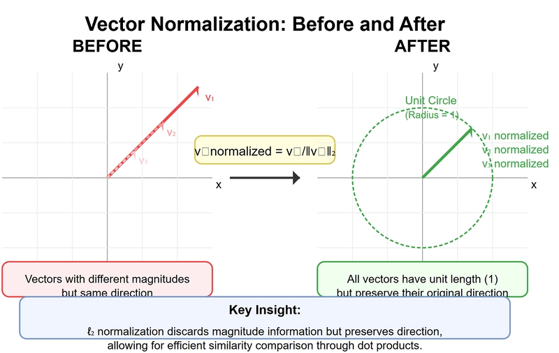

# Similarity metrics: how "close" is measured

Search needs a number that says how close two vectors are. There are three common ones, and they are closely related. The one to use is decided by how the model was trained.

## 1. Cosine similarity
```
cos(a, b) = (a . b) / (|a| x |b|)
```
- It measures the **angle** between two vectors and ignores their length.
- The range is -1 to 1. 1 means the same direction, 0 means unrelated (at right angles), -1 means opposite.
- For text embeddings, the scores of real texts are mostly between 0 and 1. A typical "clearly related" pair is above 0.6 or 0.7 and an unrelated pair is under 0.3, but **these numbers depend on the model**, so a threshold from one model does not carry over to another.
```python
def cosine(a, b):
    return float(a @ b / (np.linalg.norm(a) * np.linalg.norm(b)))
```
- Length is ignored on purpose: a long document and a short one on the same topic point the same way.

## 2. Dot product
```
a . b = sum(a[i] x b[i])
```
- It multiplies the vectors number by number and adds up.
- It depends on **both the angle and the lengths**: a longer vector gets a bigger score.
- It is the fastest to compute, because it is exactly what `@` does.

## 3. Cosine and dot product are the same on normalised vectors
- If both vectors have length 1, then `|a| x |b| = 1` and `cos(a, b) = a . b`.
- That is why the standard setup is: **normalise every vector once, then use the dot product** (note 1 of the NumPy note). The search is then a single matrix multiply, and the scores are cosines.
- Many models return unit vectors already (OpenAI embeddings are normalised to length 1; several sentence-transformers models normalise as a setting). I check with `np.linalg.norm` before I rely on it.
- If a model was trained with the raw dot product and its vector lengths carry meaning (some retrieval models), normalising throws that information away. The model's own documentation says which one it expects.

### What a unit vector is, and why I normalise (with a picture)



*The picture is a study aid; I did not record where it came from. In its formula the boxes are the subscript `i`: the normalised `v` is `v / ||v||`, the vector divided by its own length (the L2 norm).*

- **Before:** the three vectors v1, v2 and v3 point the **same way** and have **different lengths**.
- **After:** each one is divided by its own length. All three become the same vector, with length 1, on the circle of radius 1 (the unit circle). The **direction is kept, the length is thrown away.**
- **A unit vector** is a vector of length 1. In numbers: `sqrt(x1^2 + x2^2 + ... + xd^2) = 1`.
- **The formula:** `v_normalised = v / ||v||`, and in NumPy `v / np.linalg.norm(v)`. For a matrix of rows: `docs / np.linalg.norm(docs, axis=1, keepdims=True)`.

**Why it matters**
1. **A dot product mixes direction and length; I only want direction.** Take a query `q = [1, 0]`, a vector `a = [0.9, 0.1]` that points almost the same way, and a long vector `b = [3, 3]` that points 45 degrees away.
   - Raw dot products: `q . a = 0.9` and `q . b = 3`, so `b` wins, only because it is long.
   - Cosines: `q` and `a` give 0.994, and `q` and `b` give 0.707, so `a` is the better match.
   - After normalising, the dot product **is** the cosine, and `a` wins.
2. **It makes similarity one cheap operation.** Normalise once when the vectors are stored, then every search is a single `docs @ query`. No division per comparison.
3. **All the metrics agree.** For unit vectors, the order by cosine, by dot product and by Euclidean distance is the same (`distance^2 = 2 - 2 x cosine`), so it does not matter which one an index uses.
4. **Scores become comparable and a threshold means something.** A cosine is between -1 and 1 and does not depend on how long a vector is. My near-duplicate threshold of 0.97 and my "above 0.6 is related" reading both rely on scores being cosines.
5. **Vector length is usually not what an embedding model is trying to say.** For text search the meaning is in the direction. (Some models are trained to be used with the raw dot product and then the length carries information; the model's documentation says so, and I check it.)

**What to watch**
- **Both sides:** normalise the stored vectors **and** the query. A normalised library and a raw query give scores on the wrong scale.
- **Check, do not assume:** Jina's vectors in my corpus have a length of exactly 1.0 (minimum and maximum both 1.0 in the Day 9 run), and BGE-M3 was run with `normalize_embeddings=True`. I still print `np.linalg.norm` to confirm.
- **A zero vector** cannot be normalised (division by zero gives `nan`), so an empty text must be caught first.
- **Cutting a vector breaks it:** after truncating to fewer dimensions the length is no longer 1, so I normalise again (`Notes/02-renormalising-after-truncation.md`).
- **In pgvector** the cosine operator (`<=>`) takes care of the length itself; the inner-product operator (`<#>`) only equals the cosine if the vectors are already length 1.

## 4. Euclidean distance
```
dist(a, b) = sqrt(sum((a[i] - b[i])^2))        smaller = closer
```
- It is the straight-line distance between the two points. A **small** value means close, the opposite direction of the two scores above.
- On unit vectors it is directly tied to cosine:
```
dist(a, b)^2 = 2 - 2 x cos(a, b)          (for vectors of length 1)
```
- So for normalised vectors, the **ranking** by smallest Euclidean distance and by largest cosine is the same. Only the numbers differ.
- It matters when vectors are not normalised, or in algorithms that use distances directly (clustering with k-means, some indexes).

## 5. Comparison
| Metric | Larger means | Uses vector length | Range on unit vectors | Typical use |
|---|---|---|---|---|
| Cosine | more similar | no | -1 to 1 | the default for text |
| Dot product | more similar | yes | -1 to 1 (same as cosine) | fast search on normalised vectors, some trained-for-dot models |
| Euclidean distance | **less** similar | yes | 0 to 2 | clustering, some indexes |

```python
# all three for a query q against a matrix of unit-length documents (n, d)
cos   = docs @ q                                   # (n,)  larger is better
dot   = docs @ q                                   # the same numbers here
euclid = np.linalg.norm(docs - q, axis=1)          # (n,)  smaller is better
np.argsort(-cos)[:5]  ==  np.argsort(euclid)[:5]   # the same five documents
```
- The last line is a good test to run once: if it is not true, the vectors are not normalised.

## 6. Which metric each model expects
| Model or store | Expects |
|---|---|
| OpenAI `text-embedding-3-*`, vectors already unit length | cosine (equal to the dot product) |
| Gemini, Cohere, Voyage embeddings | cosine is the safe default; check each model page |
| sentence-transformers (BGE, E5, GTE, MiniLM) | cosine; many are used with the normalise option on |
| Vector databases (Day 10) | the metric is chosen when the index is created (`cosine`, `l2` or inner product); it must match the model |

- Using the wrong metric rarely crashes. It changes the order of the results a little, and a threshold set for cosine means nothing for Euclidean distance.
- **Rule for the project:** normalise, use the dot product, call the result cosine similarity, and state the metric in the benchmark note.

## 7. Thresholds
- A fixed cut-off (for example "above 0.9 is a near-duplicate", task 7) is a number I find by looking at real pairs, never one I copy.
- Scores are not probabilities. 0.8 does not mean "80% likely". Different models and different text lengths compress scores into different ranges.
- A good method: print the pairs just above and just below a candidate threshold and read them, then pick the value where my judgement flips.

## Mistakes to avoid
| Mistake | What happens |
|---|---|
| Comparing vectors from two different models | meaningless numbers: the spaces do not match |
| Dot product on un-normalised vectors, read as cosine | long or large-norm vectors win |
| Sorting Euclidean distances in descending order | the farthest documents come first |
| A threshold copied from a blog post | wrong for my model and my text |
| A metric in the vector database that differs from the model's | silent drop in quality |

## Quick check
- Why is the dot product the same as the cosine when both vectors have length 1?
- Why is "normalise once, then `@`" the standard setup?
- Which way does Euclidean distance rank: small first or large first?
- How would I choose a near-duplicate threshold?
